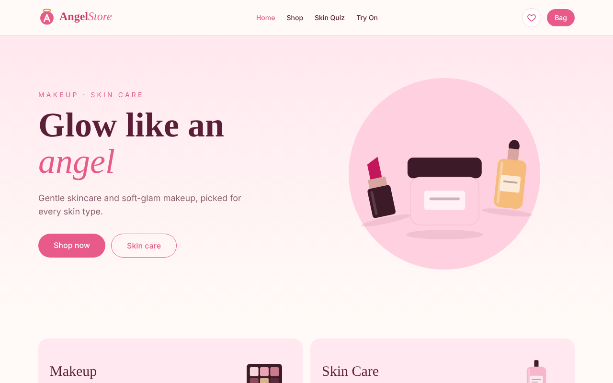
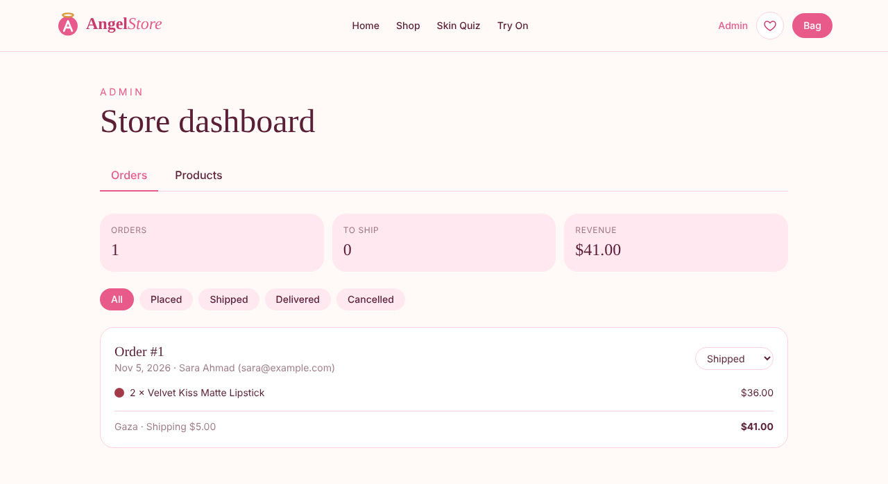

# AngelStore 🌸

A full-stack makeup & skin care store: React + TypeScript frontend, Node.js + Express REST API, and PostgreSQL. Includes a virtual try-on, a skin quiz that builds a personal routine, accounts, reviews, orders and an admin dashboard.

**Live demo:** _add your Vercel link here_ · **Demo admin:** _add if you want reviewers to try it_




## Features

**Shopping**
- Shop with category filters, search and sorting, all kept in the URL and run on the server
- Product pages with shade picker, quantity, related products and **customer reviews** (1 review per user, editable)
- **Virtual try-on**: preview lip and cheek shades on a model with 5 skin tones and add the whole look to the bag
- **Skin quiz**: 3 questions build a 3–6 step routine, added to the bag in one click
- Bag saved in the browser, with a free-shipping progress bar

**Accounts & orders**
- Register / sign in with secure httpOnly session cookies
- Wishlist saved to the account (works on every device), with optimistic updates
- Checkout that **prices the order on the server** (the browser's prices are never trusted)
- "My orders" page with order status

**Admin dashboard**
- Create, edit and delete products with a live illustration preview
- All orders with customer details, status filters, revenue stats and status updates
- Deleted products don't break past orders (each order keeps a snapshot of name and price)

**Quality**
- 27 API tests + 41 frontend tests, type-checked end to end, CI on every push
- Loading skeletons, error states with retry, accessible forms and focus styles, responsive down to 360px

## Architecture

```
Browser ──► Vercel (React app) ──/api/*──► Render (Express API) ──► Neon (PostgreSQL)
```

The frontend calls `/api/...` on its own domain. Vite (in development) and Vercel (in production) forward those requests to the API, so the session cookie is first-party and no CORS setup is needed.

| Area | Choice | Why |
|------|--------|-----|
| Frontend | React 19, TypeScript, Vite, Tailwind CSS v4 | Typed components, fast builds, brand colors as theme tokens |
| Server state | TanStack Query | Caching, loading/error states, optimistic wishlist updates |
| Client state | Zustand + persist | The bag works for guests and survives refreshes |
| API | Express 5 + Zod | Every request body and query is validated, with a message per field |
| Database | PostgreSQL + Drizzle ORM | Typed queries and versioned migrations |
| Local DB | PGlite (Postgres in WebAssembly) | `npm run dev` works with **no database install**; tests use a fresh in-memory DB |
| Auth | bcrypt + JWT in an httpOnly, SameSite cookie | Passwords are hashed; scripts in the page can't read the session |
| Security | Helmet, rate limiting on auth, server-side pricing, role checks | |
| Tests | Vitest, Supertest, Testing Library, MSW | API tests hit a real (in-memory) Postgres; UI tests use a mock API |

## Project structure

```
client/                 React app
  src/hooks/            Data hooks (useProducts, useAuth, useOrders, useAdmin...)
  src/pages/            One file per route, tests next to them
  src/components/       UI building blocks
  src/store/            Bag (Zustand)
  src/test/             Test setup, mock API (MSW), fixtures
server/                 Express API
  src/routes/           auth, products + reviews, wishlist, orders, admin (+ tests)
  src/db/               Schema, connection, seed data
  src/lib/              Auth, validation, errors, money helpers
  drizzle/              SQL migrations
render.yaml             API deployment (Render Blueprint)
```

## Run it locally

Requires Node.js 22+.

```bash
npm run setup   # install everything
npm run dev     # API on :3001 + website on :5173
```

Open http://localhost:5173. The database is created and filled with products on first start (saved in `server/.data`).

Admin login for local development: `admin@angelstore.dev` / `admin1234`

```bash
npm test        # all API and frontend tests
```

## API

| Method | Endpoint | Access |
|--------|----------|--------|
| GET | `/api/products?category&q&sort` | public |
| GET | `/api/products/:id` · `/api/products/:id/reviews` | public |
| PUT / DELETE | `/api/products/:id/reviews` | signed in |
| POST | `/api/auth/register` · `/login` · `/logout` · GET `/me` | public |
| GET · PUT · DELETE | `/api/wishlist[/:productId]` | signed in |
| POST · GET | `/api/orders` · GET `/api/orders/:id` | signed in (own orders only) |
| POST · PUT · DELETE | `/api/admin/products[/:id]` | admin |
| GET · PATCH | `/api/admin/orders[/:id]` | admin |

Errors always look like `{ "error": "message", "fields": { "email": "Please enter a valid email" } }`.

## Deploy (free tiers)

1. **Database — Neon:** create a project at neon.tech and copy the connection string.
2. **API — Render:** New → Blueprint → pick this repo. Fill in `DATABASE_URL` (from Neon), `ADMIN_EMAIL` and a strong `ADMIN_PASSWORD`. `JWT_SECRET` is generated for you. Tables are created on the first start.
3. **Website — Vercel:** import the repo, set **Root Directory** to `client`. Before deploying, put your Render URL in `client/vercel.json` in place of `YOUR-API.onrender.com`.

Brands and products are fictional; this is a portfolio project.
